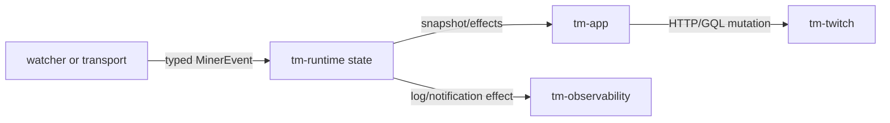

# Architecture

The project runs as a Cargo workspace with crate boundaries split by
responsibility:

- `tm-app` owns process bootstrap, task wiring, the local earnings ledger,
  the config reload task, and the immediate `--auth-status` and
  `--decrypt-session` commands.
- `tm-config` owns config/path resolution and write-back; typed streamer-setting
  composition is isolated from persistence and migration.
- `tm-auth` owns cookie persistence, including the opt-in AES-256-GCM encryption
  of the session file (the only direct use of `ring`), and device auth helpers.
- `tm-domain` owns pure logic, shared types, and the transport-neutral
  `MinerEvent` contract.
- `tm-twitch` owns Twitch HTTP, GQL, and scraping contracts. HTTP execution and
  typed response normalization remain separate modules.
- `tm-pubsub` owns the isolated PubSub `/v1` compatibility client, the Hermes client
  that event connections fail over to when PubSub keeps failing, and EventSub
  WebSocket transport. Production uses the fixed viewer-compatible topic set;
  an authenticated broadcaster may additionally use EventSub prediction topics.
  EventSub connection lifecycle, capacity planning, and protocol normalization
  are separate modules behind one facade.
- `tm-irc` owns IRC protocol handling.
- `tm-net` owns how the miner reaches the network: the optional proxy setting's
  parsing, the `NetworkPolicy` built from it at startup, and every HTTP client,
  TCP stream, and WebSocket connection. It depends on no other workspace crate.
  `tm-config` uses it only to validate the setting; `tm-app` builds the policy
  once and hands it to the clients.
- `tm-runtime` owns the single-writer runtime state model.
- `tm-observability` owns logging, privacy helpers, and notification payloads.

The built-in outbound notifiers are Discord and one generic JSON webhook, which
reaches other services without per-provider code. Further notifier backends are
intentionally out of scope unless a concrete operator requirement justifies
adding them.

Accepted point rewards are also appended to a local ledger, `earnings/YYYY-MM.jsonl`
in the data directory, which `--earnings`, the silent-loss alarms, and the daily
report read. The ledger is a file on the operator's machine, not an integration:
exporters that send earnings data to external analytics services remain out of
scope. The miner reads the ledger back for one purpose only: an hourly,
background read assigns each channel a coarse yield tier, which can break a tie
between waiting channels at a fair rotation and nothing else. A missing,
empty, or unreadable ledger leaves every channel in tier 0, which changes no
other mining decision.

## Event flow

For an ordinary WATCH credit, `tm-pubsub` parses the authenticated
`points-earned` message into `MinerEvent::PointsEarned`; the runtime updates
the tracked streamer and emits no network effect. Predictions use the same
boundary but can return an evaluation effect for `tm-app` to execute once.

The ledger is not a second state owner. `tm-app` appends one line per reward the
runtime accepted, through a bounded queue to a dedicated writer task. A full
queue or failed write only increments a counter shown in `--status`; it never
delays or fails the miner.

Source pointers: [runtime state](../crates/tm-runtime/src/state.rs),
[runtime handle](../crates/tm-runtime/src/handle.rs),
[PubSub parser](../crates/tm-pubsub/src/parse.rs),
[EventSub parser](../crates/tm-pubsub/src/eventsub/protocol.rs), and
[effect execution](../crates/tm-app/src/runtime_effects.rs).

## Internal module layout

The largest crates are decomposed behind stable crate facades:

- `tm-app` keeps `main.rs` as the executable entrypoint and splits orchestration
  into startup, shutdown, drops, independently supervised EventSub/PubSub tasks,
  presence fallback polling, runtime effects, context refresh, minute watching,
  chat, config reload, and shared utilities.
- `tm-config` keeps the stable flat schema and atomic persistence in `lib.rs`;
  `settings.rs` owns typed base/override composition and `reload.rs` owns the
  live-or-restart classification of changed settings.
- `tm-twitch` exposes the same public API from `lib.rs`; `client.rs` owns HTTP
  execution and bounded retry policy, while `responses.rs` owns strict typed
  response validation and normalization.
- `tm-pubsub` exposes the same public API from `lib.rs`; `eventsub.rs` owns the
  connection/subscription lifecycle, `eventsub/planning.rs` owns deterministic
  cost planning, and `eventsub/protocol.rs` owns wire validation, normalization,
  and bounded message deduplication.
- `tm-runtime` exposes the same public API from `lib.rs` while separating the
  serialized handle, runtime state/types, effects, prediction settlement
  helpers, and summary/history formatting.

Large private unit-test suites live under each crate's `tests/unit/` directory
and are included with `cfg(test)` path modules. They retain private access
without becoming integration targets or forcing test hooks into public APIs.

## Runtime ownership and effects

All mutable mining state remains owned by one serialized `tm-runtime` state.
Transport, polling, and watcher tasks submit typed events/updates and receive
snapshots or effect decisions; they never retain a second mutable copy. The reducer
deduplicates external mutation identifiers before returning effects. Network
mutations are executed once by `tm-app` after the runtime decision and are never
silently replayed.

Application orchestration uses contexts only where values share a lifecycle:
EventSub, PubSub, runtime-effect execution, minute watching, and offline streak
recovery. Startup, canary, and CLI paths are split by preparation, decision,
and execution responsibility. Flat serialized config structures and exhaustive
state/watch reducers stay explicit because wrapping them solely to satisfy a
line or boolean count would obscure the contract.

EventSub and PubSub task contexts embed the same `RuntimeEffectContext` used to
execute runtime-approved network effects. This removes duplicated runtime/client/
identity/observability/health wiring while leaving transport credentials and
subscription state in their narrower transport contexts.

## Config reload

A supervised `config-watch` task in `tm-app` rereads the active config file
every 30 seconds. `tm-config` previews and validates the contents without
writing and classifies each changed setting as live or needing a restart; its
rule table names every top-level key, and a test fails when a key is missing.
The reload is then applied in a fixed order:

1. Everything that can fail runs first: the follower list when the channel
   inputs changed, and each new channel through the startup identity and
   context path. A failure applies nothing and is retried at most every five
   minutes while the file is unchanged.
2. `tm-app` sends one `ConfigReload` command. The `tm-runtime` reducer replaces
   priorities and per-channel settings, appends new channels, and removes old
   ones, all under the same lock and without I/O. A channel with a placed,
   reserved, or unknown-outcome prediction is not removed, so the stake keeps
   its accounting; the task asks again until the prediction resolves. Removed
   channels are kept aside so the session summary still counts their points.
3. After the commit, the shared `AppObservability` state (notifier targets and
   filters, `emojis`, `show_claimed_bonus_msg`, `show_game`) is swapped in one
   write, so every clone sees the same values.
4. If the set of channels changed, a `TransportController` stops the current
   generation of EventSub, PubSub, and presence polling, waits for it, and
   starts the next one from a fresh runtime snapshot, since those tasks hold
   indices into the channel list. Each generation has its own stop signal that
   also fires on process shutdown, and the supervisor and the shutdown path read
   the current tasks through the controller's slots, so a restart is not a task
   exit. The chat manager already follows the runtime's channel list, and minute
   watching, context refresh, Drop handling, the streak cache, and the ledger
   read the runtime snapshot on every pass, so none of them restart.

Settings read once at startup, and changes that would start or stop a task that
exists only for some channels, are reported in the status block and left alone.

The same task refreshes streak discovery every six hours. It lists live channels
for `streak_discovery_games`, resolves the new ones, and applies all additions
and removals as one `ConfigReload` followed by one transport restart, or does
nothing when the set did not change. Discovered channels carry a `discovered`
flag, run with forced-safe settings, and are never touched by a change to
`streamers`; a name the config later lists takes the channel over in place.

## Enforced invariants

| Boundary | Invariant |
| --- | --- |
| Domain | `tm-domain` remains deterministic and has no async, HTTP, transport, tracing, CLI, or application dependency. |
| Runtime | One serialized state owner applies updates, and reducers emit effects without executing network mutations. |
| Twitch HTTP | Only classified read operations retry; mutations are not replayed after an uncertain response. |
| Transports | EventSub, PubSub, IRC, and polling are independently supervised and cannot directly own runtime state. |
| Watching | At most two Twitch-creditable slots run; an eligible campaign can pin one while the remaining slot fair-rotates. |
| Privacy | Credentials, identifiers, balances, and raw responses do not cross privacy-safe diagnostic interfaces. |
| Network | A configured proxy carries every connection and there is no direct fallback; environment proxy variables are never read. Only `tm-net` opens sockets, builds HTTP clients, or resolves names, and a source scan in its tests fails when another crate does. |
| Lifecycle | Health belongs to the current process session, and shutdown uses normal signal-driven task termination. |
| Reload | A config reload never writes the file, applies as one runtime command after every fallible step, and never removes a channel whose prediction placement is unsettled. |

`scripts/verify-architecture.ps1` rejects network/application dependencies in
`tm-domain` and prevents substantial `*_tests.rs` files from returning to
production source trees. Cargo manifests remain the source of truth for the
rest of the dependency graph.

Production workspace code forbids `unsafe`. CI also rejects production
`unwrap`, `expect`, panic, `todo!`, and `unimplemented!` shortcuts, except for
narrowly documented compile-time invariants such as the built-in default-config
schema. Test fixtures may still fail loudly.

Quality gates are handled by `.github/workflows/ci.yml`; Docker image validation and publishing remain in the multiarch workflow. Automatic self-update is intentionally absent: releases are source- and digest-pinned.
